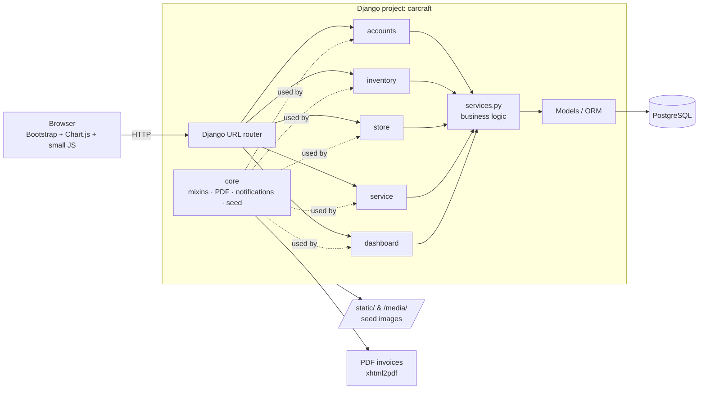
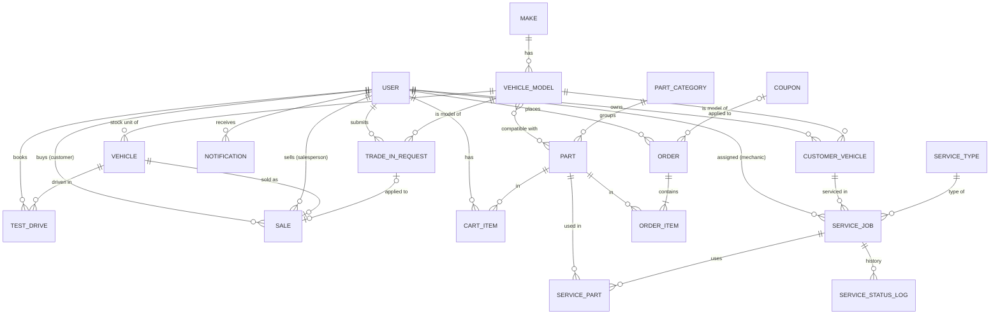
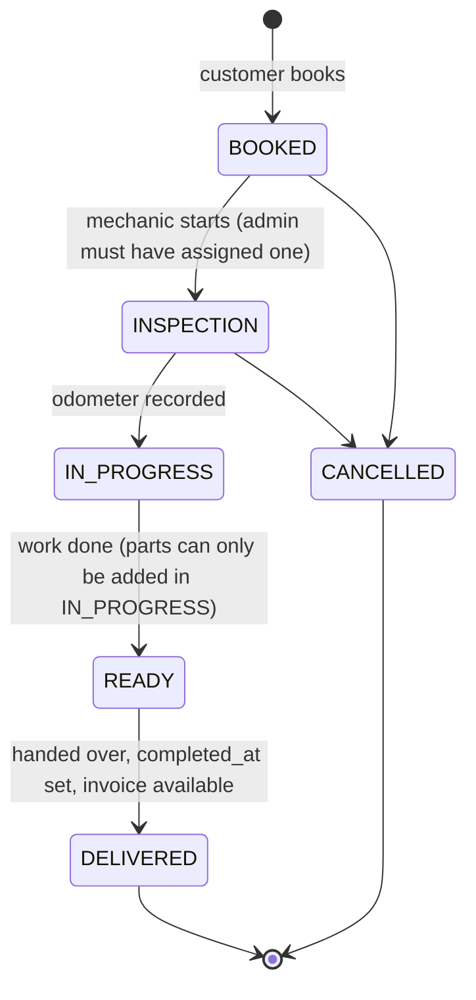

# CarCraft — Design Document

> **CarCraft: Automotive Inventory & Dealership Suite**
> Vehicle inventory and dealership management, an e-commerce store for parts and accessories, and service appointment scheduling.
>
> Project ID: P_009 · Domain: Automotive · Stack: Python, Django, Bootstrap, PostgreSQL

---

## 1. Goals and constraints

| Constraint | What it means for the design |
|---|---|
| **Demo-driven** | Every feature must look real using only seed data we generate. No feature depends on real users, real time passing, or external accounts. |
| **Low effort per feature** | Standard Django: server-rendered templates, ORM, built-in auth. No SPA, no Celery, no Docker requirement. |
| **One database** | PostgreSQL 16. We use a few Postgres-only features (`JSONField`, `ArrayField`, full-text search) where they save work. |
| **Reproducible** | `python manage.py seed --reset` gives every teammate identical data. |

### Explicitly out of scope
Real payment gateway, SMS/email delivery, multi-branch inventory, CRM pipeline, AI recommender, VIN decoder. Each has a cheap stand-in (see §4) or is a stretch goal (§12).

---

## 2. Tech stack

| Layer | Choice | Why |
|---|---|---|
| Language | Python 3.12 | |
| Framework | Django 5.x | Auth, admin, ORM, forms built in |
| Database | PostgreSQL 16 + `psycopg[binary]` 3 | JSON/array fields, full-text search |
| UI | Django templates + Bootstrap 5.3 (CDN) + Bootstrap Icons | No build step |
| Forms | `django-crispy-forms` + `crispy-bootstrap5` | Bootstrap-styled forms with one tag |
| Charts | Chart.js 4 (CDN) | Data passed as JSON from views |
| PDF | `xhtml2pdf` | Pure Python, works on Windows (WeasyPrint needs GTK) |
| Images | `Pillow` | `ImageField` |
| Seed data | `Faker` (`en_IN` locale) | Realistic Indian names, phones, addresses |
| Config | `python-dotenv` | DB credentials in `.env` |

---

## 3. High-level architecture



### Layering rule
```
template  ←  view (thin: auth, form handling, render)
                 ↓
           services.py (all business rules: checkout, stock, status changes, trade-in maths)
                 ↓
           models.py (fields, constraints, simple properties)
```
Views never change stock or status directly. They call a service function, which wraps the change in `transaction.atomic()`. This keeps the store and the service center from disagreeing about stock.

### Django apps

| App | Responsibility |
|---|---|
| `accounts` | Custom `User` with `role`, login/register, profile, role-based redirect after login |
| `inventory` | Makes, models, vehicles, search/filter, compare, EMI, test drives, sales, trade-in |
| `store` | Part categories, parts, compatibility filter, cart, coupons, checkout, orders |
| `service` | My Garage (customer vehicles), service types, service jobs, status tracker, parts used |
| `dashboard` | Role dashboards, analytics charts, low-stock alerts (no models of its own) |
| `core` | Base templates, role mixins, `Notification`, PDF helper, `seed` management command |

---

## 4. Feature map

Each row is one feature, where it lives and how it's built. Effort: **XS** < 2h · **S** ≈ half day · **M** ≈ 1 day.

| # | Feature | App | Models | Implementation | Seed needed to demo | Effort |
|---|---|---|---|---|---|---|
| F1 | **Role-based access and dashboards** | accounts, core, dashboard | `User.role` | `role` choice field on custom user. `RoleRequiredMixin(roles=[...])` and `@role_required` decorator. After login, `/dashboard/` redirects to the dashboard for that role. Navbar items shown per role. | 1 fixed login per role | S |
| F2 | **Inventory listing + filters + search** | inventory | `Make`, `VehicleModel`, `Vehicle` | `ListView` with a `GET` filter form (price range, fuel, transmission, body type, year, condition, make). Filters live in the URL so a search can be shared. Search bar uses Postgres `SearchVector` / `SearchQuery` on make, model, variant and colour. Pagination at 12 per page. | ~35 available vehicles across 8 makes | S |
| F3 | **Vehicle detail page** | inventory | `Vehicle` | Specs rendered from `specs` JSON, features from `features` array as badges. Buttons: Compare, Book test drive, EMI calculator. | Specs + features per vehicle | XS |
| F4 | **Car comparison (2–4)** | inventory | — (session) | Vehicle IDs stored in `request.session["compare"]` (max 4). `/inventory/compare/` renders a table: one row per spec key (union of keys), one column per car, cheapest price highlighted. | Consistent spec keys across vehicles | S |
| F5 | **EMI calculator** | inventory | — | Pure JS on the detail page. `EMI = P·r·(1+r)^n / ((1+r)^n − 1)` where P = price − down payment, r = annual rate/12/100, n = months. Sliders for down payment, rate and tenure, plus a yearly amortization table. | Vehicle price | XS |
| F6 | **Test-drive booking** | inventory | `TestDrive` | Customer picks a date and time slot (10:00–18:00, hourly). The service rejects double-booking the same vehicle and slot. Sales staff see a queue and can Confirm, Complete or Cancel. | ~25 test drives, past and upcoming, in all statuses | S |
| F7 | **Trade-in estimator** | inventory | `TradeInRequest` | Formula in `inventory/services.py` (see §7.4). Customer gets an instant estimate; sales staff can set `offered_value` and the status. | ~8 requests in mixed statuses + `base_price` on every model | S |
| F8 | **Record a vehicle sale** | inventory | `Sale` | Sales staff mark a vehicle sold: creates a `Sale`, sets `Vehicle.status = SOLD`, optionally links a trade-in, and adds the car to the buyer's garage (`CustomerVehicle`). | ~45 sales backdated over 12 months | S |
| F9 | **Parts catalog + "Fits my car" filter** | store | `PartCategory`, `Part` (M2M → `VehicleModel`) | Dropdowns for Make → Model (model list filtered by make with a small JS `fetch` to `/store/api/models/?make=`). Query: `Part.objects.filter(Q(compatible_models=m) \| Q(is_universal=True)).distinct()`. Logged-in customers get a one-click "My cars" chip from their garage. | ~60 parts, each linked to 2–6 models; a few universal | M |
| F10 | **Cart and checkout (mock payment)** | store | `CartItem`, `Order`, `OrderItem` | DB-backed cart per user. Checkout calls `store.services.place_order()`: validates stock, applies coupon, computes 18% GST, decrements stock, creates the order as `PAID`. The "Pay now" page is a fake gateway screen with one button. | — | M |
| F11 | **Coupons** | store | `Coupon` | Code entered at checkout. Validation: active, inside date window, `subtotal ≥ min_order`. Discount is a percentage (capped by `max_discount`) or a flat amount. | `WELCOME10`, `FLAT500`, `DIWALI25` (expired) | XS |
| F12 | **Order history and status timeline** | store | `Order` | Customer: list + detail with a Bootstrap progress bar (Paid → Shipped → Delivered). Admin: change status from the order list. | ~150 orders over 12 months, all statuses | S |
| F13 | **My Garage** | service | `CustomerVehicle` | Customer adds their cars (model, year, reg no., km). Shows service history per car and a **"Due for service"** badge if the last delivered job was over 180 days ago or the car has never been serviced. | `customer1` owns 2 cars, each with 3–4 past jobs, one overdue | S |
| F14 | **Service booking** | service | `ServiceType`, `ServiceJob` | Customer picks a garage car, a service type, a date and a complaint. Job starts at `BOOKED`. | 6 service types | S |
| F15 | **Live service status tracker** | service | `ServiceJob`, `ServiceStatusLog` | State machine in `service/services.py` (§7.2). Admin assigns a mechanic; the mechanic advances the status from their queue. Every change writes a `ServiceStatusLog` row and a `Notification`. Customer sees a stepper and a timeline. | ~12 active jobs spread across every stage | M |
| F16 | **Parts used in service → stock deduction** | service, store | `ServicePart`, `Part` | Mechanic adds parts to a job (only while `IN_PROGRESS`). Calls the same `store.services.adjust_stock()` as checkout, so stock is shared. | Shared `Part` table | S |
| F17 | **Low-stock alerts** | dashboard | `Part` | `Part.objects.filter(stock_qty__lte=F("reorder_level"))`. Red card on the admin dashboard + a dedicated page; admin can restock inline. | ~6 parts seeded at or below reorder level | XS |
| F18 | **PDF invoices** | core | `Sale`, `Order`, `ServiceJob` | `core.pdf.render_pdf(template, context)` → `HttpResponse(content_type="application/pdf")`. Three templates: vehicle sale, parts order, service invoice (labour + parts + GST). | Comes from existing records | S |
| F19 | **Analytics dashboard** | dashboard | read-only aggregates | Queries in §7.5. Chart.js charts: monthly revenue by stream (stacked bar), top 5 models (horizontal bar), revenue split (doughnut), service jobs by status (bar), plus KPI cards (revenue this month, cars in stock, average days to sell, open jobs). Chart data passed with `{{ data\|json_script:"chart-data" }}`. | 12 months of backdated history with a trend and a festive spike | M |
| F20 | **In-app notifications** | core | `Notification` | Bell icon with unread count (context processor). Created by service functions: test drive confirmed, order shipped, service status changed, trade-in offered. Stands in for email and SMS. | ~20 notifications for `customer1` | S |

### Feature → role matrix

| Feature | Customer | Sales | Mechanic | Admin |
|---|:-:|:-:|:-:|:-:|
| Browse / search / compare / EMI | ✅ | ✅ | ✅ | ✅ |
| Book test drive | ✅ | — | — | — |
| Manage test drives | — | ✅ | — | ✅ |
| Trade-in: estimate / offer | estimate | offer | — | offer |
| Record sale | — | ✅ | — | ✅ |
| Shop parts, cart, checkout | ✅ | — | — | — |
| Manage orders | own | — | — | ✅ |
| My Garage, book service | ✅ | — | — | — |
| Assign mechanic | — | — | — | ✅ |
| Advance job status, add parts used | — | — | own jobs | ✅ |
| Low stock / restock | — | — | view | ✅ |
| Analytics | — | sales charts | — | all |
| Django admin (`/admin/`) | — | — | — | ✅ |

---

## 5. Data design

### 5.1 ER diagram



### 5.2 Models by app

Conventions: every model gets `created_at = DateTimeField(default=timezone.now)`. **Don't use `auto_now_add`**, because the seed script has to backdate rows. Money is `DecimalField(max_digits=12, decimal_places=2)`. Statuses are `TextChoices`.

#### `accounts`

**User** (extends `AbstractUser`, set `AUTH_USER_MODEL = "accounts.User"` before the first migration)
| Field | Type | Notes |
|---|---|---|
| role | Char choices | `ADMIN`, `SALES`, `MECHANIC`, `CUSTOMER` (default) |
| phone | Char(15) | |
| address | Text | default shipping address |
| city | Char(60) | |

Helper properties: `is_customer`, `is_sales`, `is_mechanic`, `is_admin_role`.

#### `inventory`

**Make**: `name` (unique), `slug`, `country`, `logo` (file name of an SVG in `static/brands/`, rendered as a CSS mask so it follows the text colour in light and dark mode)

**VehicleModel**
| Field | Type | Notes |
|---|---|---|
| make | FK → Make | |
| name | Char | e.g. "City" |
| body_type | Char choices | `HATCHBACK`, `SEDAN`, `SUV`, `MUV`, `PICKUP` |
| base_price | Decimal | ex-showroom price when new, used for trade-in maths |
| | | unique (`make`, `name`) |

**Vehicle** (one physical unit in stock)
| Field | Type | Notes |
|---|---|---|
| vehicle_model | FK → VehicleModel | |
| variant | Char | "VX CVT" |
| year | PositiveSmallInt | |
| condition | Char choices | `NEW`, `USED` |
| price | Decimal | asking price |
| mileage_km | PositiveInt | 0–50 for new |
| fuel | Char choices | `PETROL`, `DIESEL`, `CNG`, `EV`, `HYBRID` |
| transmission | Char choices | `MANUAL`, `AUTOMATIC` |
| color | Char | |
| color_hex | Char(7) | paint colour, used to tint the car illustration |
| vin | Char(17) unique | generated |
| specs | **JSONField** | `{"engine_cc":1498,"power_bhp":119,"torque_nm":145,"mileage_kmpl":18.4,"seats":5,"boot_l":506,"airbags":6}` |
| features | **ArrayField(Char)** | `["Sunroof","ABS","Rear camera"]` |
| status | Char choices | `AVAILABLE`, `RESERVED`, `SOLD` |
| created_at | DateTime | = date added to stock (used for "days to sell") |

Indexes: `status`, `price`, plus a GIN index on `features`.

**TestDrive**: `vehicle` FK, `customer` FK User, `scheduled_at` DateTime, `status` (`REQUESTED`, `CONFIRMED`, `COMPLETED`, `CANCELLED`), `handled_by` FK User (sales, null), `notes`.
Constraint: `UniqueConstraint(vehicle, scheduled_at, condition=~Q(status="CANCELLED"))`.

**TradeInRequest**: `customer` FK, `vehicle_model` FK, `year`, `km_driven`, `condition_rating` (`EXCELLENT`, `GOOD`, `FAIR`, `POOR`), `estimated_value` Decimal, `offered_value` Decimal null, `status` (`PENDING`, `OFFERED`, `ACCEPTED`, `REJECTED`).

**Sale**: `vehicle` OneToOne, `customer` FK, `salesperson` FK, `sale_price` Decimal, `trade_in` OneToOne TradeInRequest null, `sold_at` DateTime.

#### `store`

**PartCategory**: `name`, `slug` (unique), `icon` (Bootstrap Icons class). Seeded: Engine & Oil, Brakes, Filters, Electrical & Lighting, Tyres & Wheels, Body & Exterior, Interior Accessories, Car Care.

**Part**
| Field | Type | Notes |
|---|---|---|
| sku | Char unique | `BRK-PAD-0012` |
| name | Char | |
| category | FK → PartCategory | |
| brand | Char | Bosch, Castrol, MRF… |
| description | Text | |
| price | Decimal | |
| stock_qty | PositiveInt | |
| reorder_level | PositiveInt | default 5 |
| is_universal | Bool | fits every car (car care, accessories) |
| compatible_models | **M2M → VehicleModel** | blank if universal |

Property: `is_low_stock`.

**CartItem**: `user` FK, `part` FK, `quantity`. Unique (`user`, `part`).

**Coupon**: `code` unique (stored upper-case), `discount_type` (`PERCENT`, `FLAT`), `value`, `max_discount` null, `min_order`, `valid_from`, `valid_to`, `is_active`.

**Order**
| Field | Type |
|---|---|
| customer | FK User |
| status | `PENDING`, `PAID`, `SHIPPED`, `DELIVERED`, `CANCELLED` |
| subtotal, discount, tax, total | Decimal |
| coupon | FK Coupon null |
| shipping_address | Text (copied at checkout) |
| created_at, paid_at, shipped_at, delivered_at | DateTime (nullable except created) |

**OrderItem**: `order` FK, `part` FK (PROTECT), `quantity`, `unit_price` (price at time of purchase).

#### `service`

**CustomerVehicle** (My Garage): `owner` FK User, `vehicle_model` FK, `year`, `reg_number` unique (`MH12AB1234`), `km_driven`, `purchased_vehicle` OneToOne Vehicle null (set when bought from us).
Property: `last_service_date`, `is_service_due` (no delivered job in the last 180 days).

**ServiceType**: `name`, `description`, `icon`, `labour_charge` Decimal, `est_hours`. Seeded: General Service, Oil & Filter Change, Brake Service, AC Service, Wheel Alignment & Balancing, Full Inspection.

**ServiceJob**
| Field | Type | Notes |
|---|---|---|
| customer_vehicle | FK CustomerVehicle | customer = `customer_vehicle.owner` |
| service_type | FK ServiceType | |
| scheduled_date | Date | |
| complaint | Text | |
| status | Char choices | `BOOKED`, `INSPECTION`, `IN_PROGRESS`, `READY`, `DELIVERED`, `CANCELLED` |
| mechanic | FK User null | role = MECHANIC |
| odometer_km | PositiveInt null | recorded at inspection |
| labour_charge | Decimal | copied from type, editable |
| created_at, completed_at | DateTime | |

Properties: `parts_total`, `grand_total`.

**ServiceStatusLog**: `job` FK, `status`, `changed_by` FK User, `note`, `created_at`.

**ServicePart**: `job` FK, `part` FK (PROTECT), `quantity`, `unit_price`.

#### `core`

**Notification**: `user` FK, `kind` (`INFO`/`SUCCESS`/`WARNING`), `icon`, `message`, `link` (URL path), `is_read`, `created_at`.

---

## 6. URL map

| URL | View | Roles |
|---|---|---|
| `/` | Home: featured cars, categories, CTA cards | all |
| `/accounts/login/`, `/logout/`, `/register/` | auth (register always creates CUSTOMER) | all |
| `/dashboard/` | redirects to the dashboard for the user's role | logged in |
| `/inventory/` | vehicle list + filters + search | all |
| `/inventory/<id>/` | detail + EMI | all |
| `/inventory/compare/`, `/compare/add/<id>/`, `/compare/remove/<id>/` | comparison | all |
| `/inventory/<id>/test-drive/` | book | customer |
| `/inventory/test-drives/` | queue + actions | sales, admin |
| `/inventory/trade-in/` | estimator form | customer |
| `/inventory/trade-ins/` | review + offer | sales, admin |
| `/inventory/<id>/sell/` | record sale | sales, admin |
| `/store/` | parts list, category + "fits my car" filters | all |
| `/store/part/<sku>/` | part detail | all |
| `/store/api/models/?make=<id>` | JSON for the dependent dropdown | all |
| `/store/cart/`, `/cart/add/<id>/`, `/cart/update/<id>/` | cart | customer |
| `/store/checkout/`, `/store/pay/<order_id>/` | checkout + mock payment | customer |
| `/store/orders/`, `/store/orders/<id>/` | order history | customer (own), admin (all) |
| `/service/garage/` | My Garage | customer |
| `/service/book/` | book service | customer |
| `/service/jobs/<id>/` | tracker + timeline | owner, assigned mechanic, admin |
| `/service/queue/` | mechanic's job queue | mechanic |
| `/service/jobs/<id>/advance/`, `/parts/add/` | status change, parts used | mechanic, admin |
| `/service/manage/` | all jobs, assign mechanic | admin |
| `/dashboard/analytics/` | charts | admin (full), sales (sales only) |
| `/dashboard/low-stock/` | low stock + restock | admin |
| `/invoice/sale/<id>/`, `/invoice/order/<id>/`, `/invoice/service/<id>/` | PDF | owner, admin |
| `/notifications/` | list, mark all read | logged in |
| `/admin/` | Django admin | superuser |

---

## 7. Key flows and business rules

### 7.1 Checkout (`store/services.py::place_order`)

```mermaid
sequenceDiagram
    actor C as Customer
    participant V as checkout view
    participant S as store.services
    participant DB as PostgreSQL
    C->>V: POST checkout (coupon code)
    V->>S: place_order(user, coupon_code)
    S->>DB: BEGIN; SELECT parts FOR UPDATE
    alt any part stock < qty
        S-->>V: raise InsufficientStock(part)
        V-->>C: error message, back to cart
    else stock ok
        S->>S: subtotal, coupon discount, GST 18%, total
        S->>DB: INSERT Order(PENDING) + OrderItems
        S->>DB: UPDATE part SET stock_qty = stock_qty - qty  (F expression)
        S->>DB: DELETE cart items; COMMIT
        V-->>C: redirect to /store/pay/<id>/
        C->>V: click "Pay now" (mock)
        V->>DB: Order → PAID, paid_at = now
    end
```

`adjust_stock(part, delta)` is the **only** function that changes `stock_qty`. It's used by checkout, service parts (F16) and restocking (F17).

### 7.2 Service job state machine



```python
ALLOWED = {
    "BOOKED": {"INSPECTION", "CANCELLED"},
    "INSPECTION": {"IN_PROGRESS", "CANCELLED"},
    "IN_PROGRESS": {"READY"},
    "READY": {"DELIVERED"},
}
def advance(job, new_status, by_user, note=""):
    # validates ALLOWED, writes ServiceStatusLog, sends Notification to the owner
```

### 7.3 Sale

`record_sale(vehicle, customer, salesperson, price, trade_in=None)`: atomic. Vehicle must be `AVAILABLE`/`RESERVED` → `SOLD`. Creates `Sale`, marks the trade-in `ACCEPTED`, and creates a `CustomerVehicle` in the buyer's garage with a generated reg number.

### 7.4 Trade-in estimate

```
age        = current_year - year
value      = base_price × 0.85 × 0.90^(age − 1)           # 15% in year one, then 10% a year
value     ×= {EXCELLENT: 1.00, GOOD: 0.90, FAIR: 0.78, POOR: 0.62}[condition]
km_excess  = max(0, km_driven - age × 12_000)               # above-average usage
value     ×= max(0.70, 1 - km_excess / 10_000 × 0.01)       # -1% per extra 10k km, capped at -30%
value      = max(value, base_price × 0.10)                  # floor at 10%
estimate   = round(value, -3)                               # nearest ₹1,000
```

### 7.5 Analytics queries

```python
# Monthly revenue, last 12 months, per stream
Sale.objects.filter(sold_at__gte=start).annotate(m=TruncMonth("sold_at")).values("m").annotate(t=Sum("sale_price"))
Order.objects.filter(status__in=PAID_STATES, paid_at__gte=start).annotate(m=TruncMonth("paid_at")).values("m").annotate(t=Sum("total"))
ServiceJob.objects.filter(status="DELIVERED", completed_at__gte=start)...  # labour + parts

# Top 5 models sold
Sale.objects.values("vehicle__vehicle_model__make__name", "vehicle__vehicle_model__name").annotate(n=Count("id")).order_by("-n")[:5]

# Average days to sell
Sale.objects.annotate(d=F("sold_at") - F("vehicle__created_at")).aggregate(Avg("d"))

# Jobs by status
ServiceJob.objects.values("status").annotate(n=Count("id"))
```
Months with no data are filled with 0 in Python so the chart's x-axis is always 12 months.

### 7.6 Search (Postgres full-text)

```python
vector = SearchVector("vehicle_model__make__name", weight="A") + SearchVector("vehicle_model__name", weight="A") \
       + SearchVector("variant", weight="B") + SearchVector("color", weight="C")
Vehicle.objects.annotate(rank=SearchRank(vector, SearchQuery(q))).filter(rank__gt=0).order_by("-rank")
```
The same pattern applies to parts (`name`, `brand`, `description`). At this data size we skip a stored `SearchVectorField`.

---

## 8. Seed data design

### 8.1 Command

```
python manage.py seed           # add data if empty
python manage.py seed --reset   # wipe app tables, then seed
```
Location: `core/management/commands/seed.py`, with the catalog data in `core/seed_data/*.py`. Starts with `random.seed(42)` and `Faker.seed(42)` so output is deterministic. All inserts run inside one transaction.

### 8.2 Volumes

| Entity | Count | How it's made |
|---|---|---|
| Users | 1 admin, 3 sales, 4 mechanics, 40 customers | fixed demo users + Faker |
| Makes | 8 | hand-written: Maruti Suzuki, Hyundai, Tata, Mahindra, Honda, Toyota, Kia, MG |
| Vehicle models | ~22 | hand-written with real body types and realistic `base_price` |
| Vehicles | 80 (35 in stock, 45 sold) | variant, colour and year chosen at random; specs from a per-model template ± small jitter |
| Sales | 45 | spread over the last 12 months |
| Test drives | 25 | 10 upcoming (REQUESTED/CONFIRMED), 15 past |
| Trade-ins | 8 | 3 pending, 3 offered, 2 accepted (linked to sales) |
| Part categories | 8 | hand-written |
| Parts | 60 | hand-written names/brands/prices; 2–6 compatible models each; 12 universal; **6 at or below reorder level** |
| Coupons | 3 | `WELCOME10` (10%, max ₹500), `FLAT500` (min ₹2,500), `DIWALI25` (expired last year) |
| Orders | 150 | 1–4 items each, over 12 months; latest 10 in PENDING/PAID/SHIPPED, rest DELIVERED; ~5 cancelled |
| Customer vehicles | ~55 | 1–2 per customer + one per sale |
| Service types | 6 | hand-written |
| Service jobs | ~130 | ~115 DELIVERED historic + **12 active, at least 2 per stage** + 3 cancelled |
| Status logs | all jobs | full history generated for each job up to its current status |
| Service parts | ~200 | 0–3 parts on jobs that reached IN_PROGRESS |
| Notifications | ~20 for `customer1` | mix of read and unread |

### 8.3 Making history look real

- **Month weights** for backdated dates: a slow upward trend plus a festive spike (Oct–Nov ≈ 1.6×) and a smaller March spike (financial-year end). Pick a month by weight, then a random day and business-hours time.
- **Ordering of timestamps**: `vehicle.created_at < sale.sold_at` (the gap is the "days to sell", 10–90 days); `order.created_at ≤ paid_at ≤ shipped_at ≤ delivered_at`; status logs are spaced hours apart.
- **Stock consistency**: seed the *final* stock directly. Don't replay historic deductions, otherwise random history could push stock negative.
- **Images**: no photo files. Cars are drawn as inline SVG side profiles (one per body type, `templates/partials/car_sprite.html`) filled with each car's `color_hex`; makes use Simple Icons brand SVGs in `static/brands/`; parts use their category's Bootstrap icon on a tinted tile. Nothing can break and everything follows dark mode.

### 8.4 Demo accounts (password for all: `demo1234`)

| Username | Role | What's interesting |
|---|---|---|
| `admin` | Admin (+ superuser) | full analytics, low stock, mechanic assignment |
| `sales1` | Sales | upcoming test drives, pending trade-ins |
| `mech1` | Mechanic | jobs at INSPECTION and IN_PROGRESS in their queue |
| `customer1` | Customer | 2 garage cars (one due for service), an active job at IN_PROGRESS, a SHIPPED order, unread notifications |

---

## 9. Project structure

```
car-craft/
├── manage.py
├── requirements.txt
├── .env.example                 # DB_NAME, DB_USER, DB_PASSWORD, DB_HOST, DB_PORT, SECRET_KEY, DEBUG
├── carcraft/                    # project package
│   ├── settings.py
│   └── urls.py
├── accounts/                    # models, views, forms, urls, admin
├── inventory/                   # + services.py (sale, trade-in, test drive)
├── store/                       # + services.py (adjust_stock, place_order, coupons)
├── service/                     # + services.py (advance, add_part)
├── dashboard/                   # views + queries.py (analytics)
├── core/
│   ├── mixins.py                # RoleRequiredMixin, role_required
│   ├── pdf.py                   # render_pdf()
│   ├── context_processors.py    # unread notifications count, compare count
│   ├── management/commands/seed.py
│   └── seed_data/               # makes_models.py, parts.py, service_types.py
├── templates/
│   ├── base.html                # navbar per role, messages, footer
│   ├── partials/                # vehicle_card, part_card, status_stepper, pagination
│   ├── accounts/ inventory/ store/ service/ dashboard/
│   └── invoices/                # sale.html, order.html, service.html (PDF)
├── static/
│   ├── css/app.css
│   ├── js/emi.js, compare.js, fits-my-car.js
│   └── seed/                    # bundled demo images
└── docs/DESIGN.md
```

---

## 10. Build order

Each phase ends with something demo-able.

| Phase | Scope | Features |
|---|---|---|
| 0 · Setup | Project, Postgres connection, custom `User`, base template, role mixins | F1 (skeleton) |
| 1 · Inventory | Models, admin, list/detail/filter/search, compare, EMI | F2–F5 |
| 2 · Seed v1 | Users, makes, models, vehicles, parts, coupons, service types | — |
| 3 · Store | Parts catalog, fits-my-car, cart, checkout, coupons, orders | F9–F12 |
| 4 · Service | Garage, booking, state machine, mechanic queue, parts used, low stock | F13–F17 |
| 5 · Sales ops | Test drives, trade-in, record sale | F6–F8 |
| 6 · Seed v2 | 12-month history: sales, orders, jobs, logs, notifications | — |
| 7 · Insight | Analytics dashboard, PDFs, notifications, role dashboards polished | F18–F20, F1 |
| 8 · Polish | Empty states, form validation messages, mobile check, README | — |

---

## 11. Demo script (~8 minutes)

1. **Visitor**: home → inventory → filter "SUV, Automatic, under ₹15L" → search "creta" → compare 3 cars → EMI sliders.
2. **`customer1`**: book a test drive → trade-in estimate → store → "Fits my car: Hyundai Creta" → add to cart → apply `WELCOME10` (then try `DIWALI25` to show the expired error) → mock pay → download invoice PDF.
3. **`customer1`**: My Garage → "Due for service" badge → open the active job and show the tracker timeline.
4. **`mech1`**: queue → add brake pads to the IN_PROGRESS job → advance to READY.
5. **`customer1`**: bell shows "Your car is ready", tracker updated.
6. **`sales1`**: confirm the test drive → make a trade-in offer → record a sale.
7. **`admin`**: analytics (festive spike, top models, days to sell) → low-stock alert now includes the brake pads → restock → `/admin/`.

---

## 12. Stretch goals (only if time remains)

| Idea | Cost | Note |
|---|---|---|
| Wishlist | XS | M2M `User ↔ Vehicle` |
| Reviews & ratings on parts | S | `Review(part, user, rating, text)`; seed ~100 |
| Stock movement ledger | S | `StockMovement(part, delta, reason, ref)` written by `adjust_stock()` |
| VIN decoder | S | NHTSA vPIC free API; needs internet during the demo |
| Car recommender | M | rule-based quiz (budget, seats, fuel) → filtered query; no AI needed |

---

## 13. Signature features

### 13.1 Car Passport (`passport` app)

A history report for any registration number that also explains the car's value line by line.

**Data:** a simulated registry shaped like what licensed RC/VAHAN APIs return.

| Model | Holds |
|---|---|
| `RegistryRecord` | reg number, model, year, registration date, RTO, open loan (`hypothecated_to`), insurance and PUC validity |
| `OwnershipPeriod` | owner serial, event (new / sale / interstate), from–to dates, city/state, lender and loan-closed date. **No owner names.** |
| `Challan` | offence, date, city, fine, status (paid / pending / court), which owner |
| `InsuranceClaim` | kind (minor / major / flood / glass), date, amount, insurer |
| `OdometerReading` | date, km, source (PDI, service, CarCraft service, PUC, insurance renewal) |

**Valuation** (`passport/valuation.py`) starts from the trade-in estimate (§7.4) and applies explainable adjustments:

| Signal | Price effect | Trust score |
|---|---|---|
| Owners | 2nd −3%, 3rd −6%, 4th+ −10% | −5 per extra owner |
| Interstate transfer | −1% | −3 |
| Hard-driving challans (overspeeding, red light, dangerous driving) | none: +1% · 1–2: −1% · 3–5: −3% · 6+: −5% | −4 each, max −25 |
| Pending challans | minus the exact rupee amount (cleared before RC transfer) | −5 |
| Insurance claims | minor −2%, glass −0.5%, major −6%, flood −15% (cap −25%) | −4 / −12 / −30 |
| Odometer reading lower than an earlier one | −8% | −45 |
| 2+ services at CarCraft | +2% | +3 |

Grades: **A** ≥ 85, **B** ≥ 70, **C** ≥ 50, **D** below. Parking, seatbelt and paperwork challans are listed but don't move the price, because they don't say anything about mechanical wear.

**Where it appears:** `/passport/` (search plus four sample "story" cars), `/passport/<reg>/` (full report with waterfall, odometer chart, timeline), the trade-in form (enter a reg number to get the history-adjusted value), pre-owned car pages, the sales trade-in queue (grade and red-flag icons), and My Garage ("worth today").

### 13.2 Same-EMI Upgrade Planner (`/inventory/upgrade/`)

For a car in the customer's garage: **equity = passport value − loan outstanding**. Every in-stock car that's a real step up (≥ 1.6× the trade-in value, or 2+ model years newer) is priced as `EMI(price − equity − extra down payment, rate, tenure)` and compared with the current EMI. Results are grouped as *Same EMI or less* (≤ +₹1,000), *A small step up* (≤ +₹4,000) and *Worth the stretch* (≤ +₹10,000). Loan amount, current EMI, extra down payment, tenure and rate are all adjustable.

### 13.3 Future scope: live registry integration

Swap the mock registry for live data through licensed providers (VAHAN-backed RC APIs, e-challan, insurer claim data), and clear pending challans automatically as part of RC transfer. The models already mirror the shape of that data. What limits it today:
- **Cost:** per-lookup API fees.
- **Consent:** the owner must authorise each lookup.
- **Data protection:** India's DPDP Act governs how owner data is stored and shown, which is why the passport never stores names.
- **Coverage:** challan data varies by state; claim history and other workshops' odometer readings need insurer and OEM partnerships.
